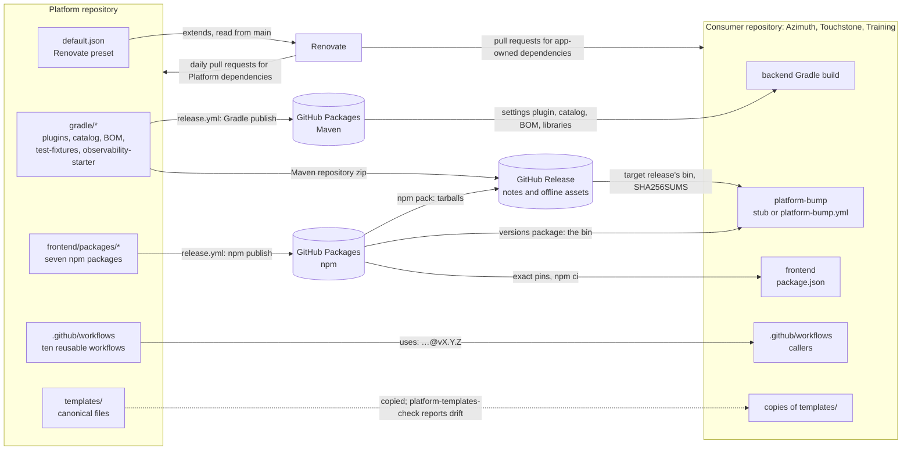
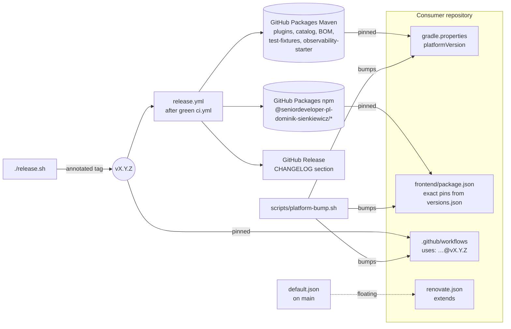
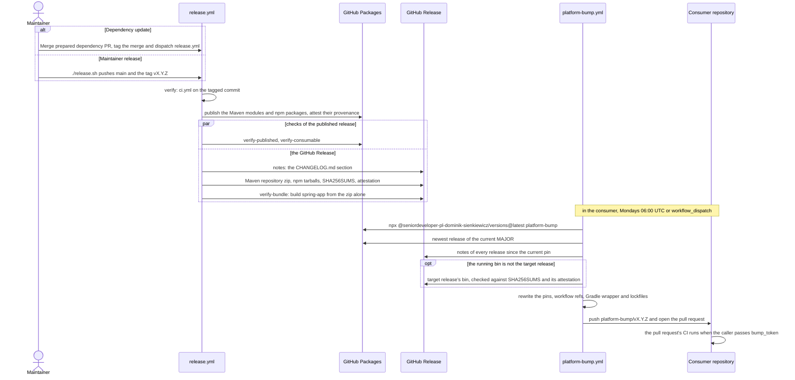
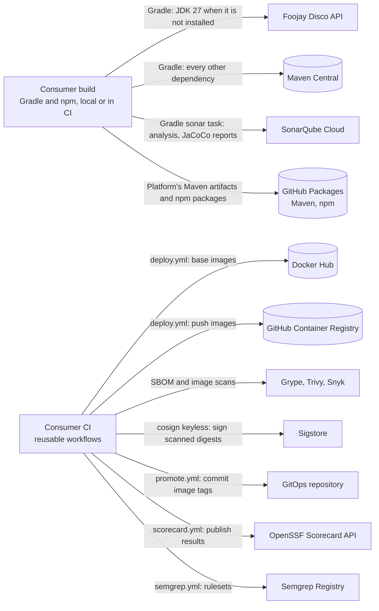
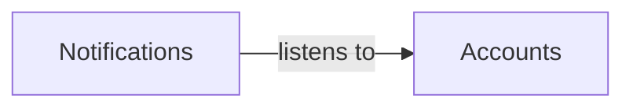

# Platform

**Designed and maintained by [Dominik Sienkiewicz](https://www.linkedin.com/in/dominik-sienkiewicz/), built with AI coding agents:** I set the architecture, write the specifications, define the quality gates enforced in CI and review every change. How that works: [engineering with agents](docs/engineering-with-agents.md).

A shared build platform for a multi-repository JVM and frontend organisation. Build
configuration, quality gates, the versions of the shared frame and frontend presets live here once,
are published as versioned artifacts, and are consumed like any other dependency.


[](https://github.com/SeniorDeveloper-pl-Dominik-Sienkiewicz/Platform/actions/workflows/ci.yml)
[](https://github.com/SeniorDeveloper-pl-Dominik-Sienkiewicz/Platform/tags)
[](LICENSE)

**Reviewing this repository?** Start with [the tour](docs/tour.md): nine stops, each a problem, the code that
solves it and the guard that keeps it solved, with [incident notes](docs/notes/) behind several of them.

> Registry: **GitHub Packages** (Maven + npm). Frontend workspaces: **pnpm** in this repository;
> consumers use **npm** with a committed `package-lock.json`, because `frontend-ci` runs `npm ci`
> and `platform-bump` updates that lockfile.

## Why this exists

Several product repositories grew from one template and drifted apart — different
formatters, different dependency versions, the same fix applied three times or forgotten
in two. Copying configuration between repositories is what caused the drift, so the
platform does not copy it: it publishes it.

The reason this is a separate repository rather than shared build logic is a constraint,
not a preference. **`buildSrc` and composite builds are scoped to a single repository** —
neither can be consumed across a repository boundary. A published, versioned artifact is
the only mechanism that crosses that boundary, which also means a consumer upgrades on its
own schedule and rolls back by pinning an older version.

Platform governs the frame, not every dependency
([ADR-0037](docs/adr/0037-platform-governs-the-frame.md)). The frame is Java, Gradle, the Spring BOMs,
the libraries in the catalog and the frontend canon. A consumer cannot give them another version, and an
explicit version of a library a Spring or Platform BOM manages fails the build
([gates](docs/gates.md#gradle)). A library only one repository uses belongs to that repository: a Gradle
build declares it in a second catalog `appLibs` read from `backend/gradle/app.versions.toml`, a frontend
pins its exact version in `package.json`, and neither needs a Platform release. A library joins the frame
when a second repository needs it.

## What it publishes

The 2.0.0 distribution uses the organization npm scope `@seniordeveloper-pl-dominik-sienkiewicz`.
Existing 1.x npm versions keep their original scope. The Maven repository is
`https://maven.pkg.github.com/seniordeveloper-pl-dominik-sienkiewicz/Platform`.
After 2.0.0 is published, existing consumers can [move from 1.x](docs/consuming.md#move-a-1x-consumer-to-200).

| Path | Artifact | Published to |
|---|---|---|
| `gradle/build-logic/` | six convention plugins (`seniordev.*-conventions`, including settings, the multi-module Sonar root and the opt-in nullness check) | GitHub Packages (Maven) |
| `gradle/catalog/` | version catalog (`pl.seniordeveloper:platform-catalog`) with the libraries and plugins of the frame | GitHub Packages (Maven) |
| `gradle/bom/` | `pl.seniordeveloper:platform-bom` — imports of the Spring BOMs, CVE floors and compatibility overrides with their reasons, from the catalog's versions | GitHub Packages (Maven) |
| `gradle/observability-starter/` | `pl.seniordeveloper:platform-observability-starter` — actuator, probes and metrics defaults, opt-in Prometheus and a `tracing` feature, with which a server span answered 5xx has the status `ERROR` | GitHub Packages (Maven) |
| `gradle/test-fixtures/` | `pl.seniordeveloper:platform-test-fixtures` (Testcontainers, test databases, migration and OpenAPI contract guards) | GitHub Packages (Maven) |
| `frontend/packages/tsconfig/` | `@seniordeveloper-pl-dominik-sienkiewicz/tsconfig` | GitHub Packages (npm) |
| `frontend/packages/eslint-config/` | `@seniordeveloper-pl-dominik-sienkiewicz/eslint-config` | GitHub Packages (npm) |
| `frontend/packages/tailwind-preset/` | `@seniordeveloper-pl-dominik-sienkiewicz/tailwind-preset` (CSS-first `@theme`) | GitHub Packages (npm) |
| `frontend/packages/vitest-config/` | `@seniordeveloper-pl-dominik-sienkiewicz/vitest-config` (jsdom + Testing Library) | GitHub Packages (npm) |
| `frontend/packages/prettier-config/` | `@seniordeveloper-pl-dominik-sienkiewicz/prettier-config` — Prettier with the Tailwind class sorter | GitHub Packages (npm) |
| `frontend/packages/versions/` | `@seniordeveloper-pl-dominik-sienkiewicz/versions` — the frontend version canon, the `platform-versions-check` guard that `frontend-ci` runs in strict mode, the `platform-bump` bin, the `platform-templates-check` drift report, `platform-workflows-check`, which holds callers to the reusable workflow contract, and `platform-doctor`, which diagnoses a repository against Platform's preconditions | GitHub Packages (npm) |
| `frontend/packages/openapi/` | `@seniordeveloper-pl-dominik-sienkiewicz/openapi` — `platform-openapi-gen` and `platform-openapi-check`: TypeScript types generated from the committed OpenAPI spec | GitHub Packages (npm) |
| `.github/workflows/` | ten reusable workflows, listed [below](#reusable-workflows) | called as `uses: …@vX.Y.Z` |
| `default.json` | shared Renovate preset: it updates what the application owns (its Gradle and npm dependencies, pinned exactly, GitHub Actions and Docker images) and leaves the frame and every Platform pin to `platform-bump`; `scripts/renovate-preset.py` generates those rules from the catalog and the frontend canon | `extends: github>SeniorDeveloper-pl-Dominik-Sienkiewicz/Platform` |
| `templates/` | canonical files every repository keeps a copy of: the JVM starters, `.editorconfig`, `.sdkmanrc`, the `.gitignore` set, `Dockerfile.backend`, `npmrc`, `grype.yaml`, the scripts `merge.sh`, `platform-bump.sh` (stub), `bump-version.sh` and `agent-gradle.sh`, and the GitHub files; each one is listed in [templates/README.md](templates/README.md) | copied; `platform-templates-check` reports drift |
| `releases/yanked.txt` | releases `platform-bump` no longer offers, with the reason and the replacement ([runbook](docs/runbooks/rollback.md)) | read from `main` by `platform-bump` |
| `scripts/` | scripts Platform's own workflows run: `promote-image.sh` (sets the image tags in a GitOps repository, run by `promote.yml`), `changelog-section.sh` and `release-notes.sh` (release notes), `release-assets.sh` (the credential-free files of a GitHub Release), `new-consumer.sh` (a new repository rendered from the canon, `--frontend next` included), `check-doc-links.py` (offline link and anchor check of the Markdown), `canon-diff.py` (the consumer impact of a pull request, run by `consumer-impact.yml`, on the engine the bump's `--report` shares), `verify-consumable.sh` (the release resolves as a consumer resolves it), `canon-package-json.mjs` (canon CVE scan), and the maintainer's `consumer-audit.sh`, `repo-settings.sh` (GitHub settings as code, with `.github/rulesets/`) and `write-verification-metadata.sh` (Gradle dependency verification of Platform's modules) | not published |

Every published artifact, with its exact coordinates, and how a release reaches each registry are
described in [RELEASING.md](RELEASING.md).

### From source to consumer

Each source area reaches a consumer repository through its own channel, and every arrow names what crosses it.



In a repository without a frontend, the `scripts/platform-bump.sh` stub takes the bin from the GitHub Release
assets instead of `frontend/node_modules`; `platform-bump.yml` always starts it with `npx` from GitHub Packages.

## Consumers

| Repository | Layout |
|---|---|
| `SeniorDeveloper-pl-Dominik-Sienkiewicz/Azimuth` | backend and frontend |
| `SeniorDeveloper-pl-Dominik-Sienkiewicz/Touchstone` | multi-module backend, no frontend |
| `SeniorDeveloper-pl-Dominik-Sienkiewicz/Training` | backend and frontend |

The list is [`scripts/consumers.txt`](scripts/consumers.txt), which
`scripts/consumer-audit.sh` reads: it prints each repository's Platform pin, Gradle wrapper, runtime
image, Platform artifacts, npm pins, workflow references and `platform-bump.yml` caller, with GET requests
only. Its output describes private repositories, so it runs on the maintainer's machine, not in CI.

### Reusable workflows

Consumers call them as `uses: SeniorDeveloper-pl-Dominik-Sienkiewicz/Platform/.github/workflows/<name>.yml@vX.Y.Z`, with
the tag of their Platform pin. Triggers are declared by the calling workflow; the platform keeps only
the logic. What each caller must grant and pass, with a snippet per workflow, is in
[docs/reusable-workflows.md](docs/reusable-workflows.md).

| Workflow | What it does |
|---|---|
| `backend-ci.yml` | runs the Gradle tasks of a Spring backend (default `build`) on the platform toolchain |
| `frontend-ci.yml` | installs, lints, type-checks, tests and builds a frontend; `strict: true` makes every standard script and the `platform-versions-check` guard mandatory, and checks the OpenAPI types of a repository that configures `platform.openapi` |
| `api-contract.yml` | fails a pull request that breaks the committed OpenAPI spec (oasdiff), unless it carries the `api-breaking` label; see [docs/api-contracts.md](docs/api-contracts.md) |
| `scorecard.yml` | OpenSSF Scorecard |
| `security-scan.yml` | dependency CVE scan: CycloneDX SBOM + Grype for the backend, `package-lock.json` for the frontend; CRITICAL and HIGH fail the build |
| `semgrep.yml` | Semgrep SAST over the source code |
| `container-scan.yml` | scans published images: Grype is the gate, Snyk a non-blocking second opinion |
| `deploy.yml` | builds and pushes images to GHCR; with `scan-images`, gates them by digest with Grype and Trivy and signs them with cosign keyless only after both pass; it deploys nothing, `promote.yml` calls it |
| `promote.yml` | builds and pushes the images through `deploy.yml` without SSH, gates them with Grype and Trivy and signs them keyless (one image with `single-image`), then commits the new image tags to a GitOps repository with a GitHub App token, for a cluster that Argo CD syncs |
| `platform-bump.yml` | bumps the repository to a Platform release and opens a pull request with the diff, release notes and consumer actions |

### Convention plugins

| Plugin | What it brings |
|---|---|
| `seniordev.settings-conventions` | applied in `settings.gradle.kts`: the Foojay toolchain resolver and the dependency repositories (an optional `platformRepository`, Maven Central, GitHub Packages) |
| `seniordev.java-conventions` | toolchain 27, Spotless (Google Java Format), Checkstyle (`maxWarnings=0`), JaCoCo with coverage summed across `test` **and** `integrationTest`, a configurable coverage threshold (`coverageMinimum`, default 0.00), and the dependency version and runtime image gates |
| `seniordev.quality-conventions` | PIT (mutation testing), SpotBugs (report-only, see [ADR-0005](docs/adr/0005-spotbugs-report-only.md)), CycloneDX (SBOM), SonarQube Cloud from the root of a single-module build |
| `seniordev.sonar-conventions` | the root of a multi-module build: one SonarQube Cloud analysis that collects the JaCoCo report of every module |
| `seniordev.nullness-conventions` | opt-in: Error Prone with NullAway in JSpecify mode, failing `compileJava` on a null dereference in packages marked `@NullMarked` |
| `seniordev.spring-modulith-conventions` | `platform-bom` (Boot / Modulith / Spring AI / JUnit BOMs with the CVE floors and the JDK 27 overrides), shared test dependencies (Modulith-test, Testcontainers, ArchUnit), and a unit ‖ integration ‖ model test taxonomy |

Every task, property and default they add is listed in [docs/reference.md](docs/reference.md).

## How it fits together



Three channels are pinned to one release: the Gradle plugins and catalog, the npm packages and the
reusable workflows. `platform-bump` moves all three and prints the notes of every release it
crosses. One reference floats: the
Renovate preset is read from `main` on every Renovate run. There is no floating workflow tag: a caller
pins the exact tag ([ADR-0002](docs/adr/0002-release-and-versioning-contract.md)).

At 04:23 UTC each day, GitHub Actions checks the JVM catalog, frontend canon and GitHub Actions
pins for stable updates. Renovate opens a PR with the proposed dependencies. The daily job adds the
Platform version, lockfiles, checksums and changelog. Merging the reviewed PR tags the merge commit
and starts release verification. [Setup and release procedure](RELEASING.md#daily-dependency-releases).

### From a tag to a consumer pull request

Read it top to bottom: nothing is published before `ci.yml` passes on the tagged commit, and a consumer adopts
the release through a pull request, never by itself.



Without `bump_token` the pull request is opened with `GITHUB_TOKEN`, so its CI does not start and the workflow
refs stay unchanged; the caller and its secrets are described in [docs/reusable-workflows.md](docs/reusable-workflows.md).

## Integrations

Platform runs no service of its own: its code runs in a consumer's Gradle build and in the workflows a consumer
calls, and from there it reaches the services below.

Read it from the left: the two places Platform's code runs in a consumer, and the external service each call goes to.



Every external service Platform's build logic and workflows call, including those only Platform's own workflows
use. The logos only identify the services.

| Logo | Service | Purpose | Interface | Status |
|---|---|---|---|---|
|  | GitHub Packages | Registry of every Maven artifact and npm package of a release; it refuses anonymous reads, so consumers resolve them with a classic PAT with `read:packages` | Maven repository `https://maven.pkg.github.com/seniordeveloper-pl-dominik-sienkiewicz/Platform`, npm registry `https://npm.pkg.github.com`, the Packages REST API for the released versions | Published by `release.yml` on every `vX.Y.Z` tag |
|  | GitHub Releases | The notes of each release, and its credential-free assets: the offline Maven repository, the npm tarballs, `SHA256SUMS` and the attestation bundle; `platform-bump` takes the target release's bin from them | `gh release` in `release.yml`; the Releases REST API and HTTPS downloads in `platform-bump` | Every release; assets since 1.6.0 |
|  | GitHub Actions | Platform's own CI, release, scans and canary, and the ten reusable workflows consumers call | `workflow_call`; `uses: SeniorDeveloper-pl-Dominik-Sienkiewicz/Platform/.github/workflows/<name>.yml@vX.Y.Z` | On |
|  | GitHub Container Registry | The images `deploy.yml` builds and pushes and `container-scan.yml` scans; cosign stores their signatures next to them | `docker/login-action` and `docker/build-push-action` on `ghcr.io` | In consumers that call `deploy.yml` or `promote.yml` |
|  | GitOps repository | `promote.yml` commits the new image tags with `scripts/promote-image.sh`, for a cluster that Argo CD syncs | GitHub App token from `actions/create-github-app-token`, `git push` | In consumers that call `promote.yml` |
|  | GitHub code scanning (CodeQL) | SAST of Platform's own code; the alerts appear in Code scanning | `github/codeql-action` in `codeql.yml` | Platform only: pushes, pull requests and Mondays |
|  | Renovate | Proposes Platform catalog, frontend and Actions updates. Consumers use the shared preset for application-owned dependencies | Platform’s `renovate.json` and the shared `default.json` preset | Daily in Platform after GitHub App setup, also in consumers that extend the preset |
|  | Maven Central | Every dependency that is not a Platform artifact | `mavenCentral()` declared by `seniordev.settings-conventions` | Every consumer build |
| | Foojay Disco API | Downloads the JDK 27 toolchain on a machine without it | `org.gradle.toolchains.foojay-resolver-convention`, applied by `seniordev.settings-conventions` | Local builds; the reusable workflows install the JDK with `setup-java` instead |
|  | SonarQube Cloud | Static analysis and coverage of consumer code in the `dominiksienkiewicz` organization | `org.sonarqube` Gradle plugin, applied by `seniordev.quality-conventions` or `seniordev.sonar-conventions`; `https://sonarcloud.io` | Consumers; Platform does not analyse itself ([ADR-0012](docs/adr/0012-platform-scans-itself-in-sonarqube-cloud.md) is superseded) |
|  | Docker Hub | Base images of the canonical Dockerfiles (`sapmachine:27-jre`, `node:24-slim`); `upstream-canary.yml` looks for an `eclipse-temurin` image of the toolchain | `FROM` in `templates/Dockerfile.backend` and `templates/Dockerfile.frontend`; `docker manifest inspect` | On |
| | Grype | The blocking CVE gate for SBOMs and images | `anchore/scan-action` in `security-scan.yml`, `container-scan.yml`, `deploy.yml`, `canon-cve-scan.yml` and `upstream-canary.yml` | On |
|  | Trivy | The second gate on a pushed image digest | `aquasecurity/setup-trivy` and `trivy image` in `deploy.yml` | With `scan-images` |
|  | Snyk | A non-blocking second opinion on images and a monitoring dashboard | Snyk CLI in the digest-pinned `snyk/snyk:docker` image, `SNYK_TOKEN` | Only when the caller passes a Snyk token |
| | Sigstore | Keyless signatures of the scanned image digests with an entry in the public Rekor log, and the provenance attestations of the release files that `platform-bump` verifies | `cosign` from `sigstore/cosign-installer`; `actions/attest`; `gh attestation verify` | Every release; image signing with `scan-images` |
| | OpenSSF Scorecard | A published supply-chain score of the repository | `ossf/scorecard-action` with `publish_results` in `scorecard.yml` | Callers, and Platform's `self-scan.yml` |
| | Semgrep Registry | The SAST rulesets (`p/default`, `p/secrets`, `p/java` and others) | `semgrep scan --config` with the CLI installed by `pipx` in `semgrep.yml` | Callers, and Platform's `self-scan.yml` |
|  | Gradle services | The current Gradle release candidate, on which `upstream-canary.yml` builds a starter | `https://services.gradle.org/versions/release-candidate` | Platform only, Mondays |

What each scan gates and how a finding is accepted is in [docs/security-scanning.md](docs/security-scanning.md).

## Reference consumers

[`templates/jvm/`](templates/jvm/) contains a pure Java library and a minimal Spring
application. Gradle TestKit consumes locally published plugins and catalog artifacts
using these templates. Main CI includes all five published Maven modules of `gradle/maven-modules.txt`.
Consumers can opt into mandatory frontend checks with `strict: true`.

Platform's own Java modules, `test-fixtures` and `observability-starter`, apply `seniordev.java-conventions`
and `seniordev.quality-conventions` from `gradle/build-logic` through `includeBuild`, so the code shipped
to consumers passes the same Spotless, Checkstyle, coverage, `platformDependencyCheck` and SpotBugs gates;
they compile to the same Java 27 bytecode as consumers' code.

### The starter's modules

The Spring starter, [`templates/jvm/spring-app`](templates/jvm/spring-app/), has two Spring Modulith
modules: `accounts` publishes `AccountOpened`, and `notifications` listens to it. A consumer gets this
diagram from `AbstractModulithDocumentationTest`, as `build/spring-modulith-docs/modules.mmd` next to the
PlantUML. A unit test of `platform-test-fixtures` compiles the starter, renders its modules the same way and
fails when they differ from [`docs/diagrams/spring-app-modules.mmd`](docs/diagrams/spring-app-modules.mmd);
`scripts/docs-gen.sh` keeps the block below equal to that file.

<!-- include: docs/diagrams/spring-app-modules.mmd -->


### Try it without credentials

GitHub Packages refuses anonymous reads, so resolving Platform from it needs a token even though the
repository is public. Every GitHub Release from 1.6.0 on therefore carries the release as files:
`platform-maven-repo-X.Y.Z.zip` (a Maven repository with every module of `gradle/maven-modules.txt`), the npm tarballs and
`SHA256SUMS`, all attested. Build a starter from them without a token:

```bash
gh release download vX.Y.Z --repo SeniorDeveloper-pl-Dominik-Sienkiewicz/Platform --pattern 'platform-maven-repo-*.zip' --pattern SHA256SUMS
```

```bash
sha256sum --check --ignore-missing SHA256SUMS && unzip -q platform-maven-repo-X.Y.Z.zip
```

```bash
cp -R templates/jvm/java-library /tmp/try-platform && sed -i.bak 's/^platformVersion=.*/platformVersion=X.Y.Z/' /tmp/try-platform/gradle.properties
```

```bash
(cd /tmp/try-platform && ./gradlew build -PplatformRepository="file://$PWD/platform-maven-repo")
```

`release.yml` proves this on every release: its `verify-bundle` job builds the `spring-app` starter from the
zip alone, with an empty Gradle home and no `GITHUB_TOKEN`.

## Documentation

- **A reviewer's tour, incident notes and how agents build it** → [docs/tour.md](docs/tour.md),
  [docs/notes/](docs/notes/), [docs/engineering-with-agents.md](docs/engineering-with-agents.md).
- **Guidance for coding agents** → [AGENTS.md](AGENTS.md) for this repository, the
  [rule sheet](docs/consumer-agents.md) and the [runbooks](docs/runbooks/README.md) for consumer repositories.
- **Consuming the platform in a product repository** → **[docs/consuming.md](docs/consuming.md)** —
  the Gradle `settings.gradle.kts` and `build.gradle.kts` wiring, and the frontend
  `tsconfig` / ESLint / Tailwind / Vitest setup.
- **Every task, property and default the plugins add** → **[docs/reference.md](docs/reference.md)** —
  with the observability starter properties and the test fixtures.
- **Building and publishing locally** → **[docs/local-development.md](docs/local-development.md)** —
  bootstrap, GitHub Packages credentials, and how a local build works without GitHub.
- **Where versions are declared** → **[docs/versions.md](docs/versions.md)** — the single
  source of truth, the versions the convention plugins take from it, and dependency locking.
- **Which Java, Gradle, Spring and Node each release brings** →
  **[docs/compatibility.md](docs/compatibility.md)**.
- **Releasing a new version** → **[RELEASING.md](RELEASING.md)** — what a release publishes,
  idempotency per registry, and how consumers adopt the new version.
- **What changed and what consumers must do** → **[CHANGELOG.md](CHANGELOG.md)**.
- **Canonical files to copy into a repository** → [templates/README.md](templates/README.md).
- **Design decisions** → [`docs/adr/`](docs/adr/), including the
  [release and versioning contract](docs/adr/0002-release-and-versioning-contract.md).
- **What the security scans gate, how to accept a finding and how images are signed** →
  [docs/security-scanning.md](docs/security-scanning.md).
- **Contributing** → [CONTRIBUTING.md](CONTRIBUTING.md) and the [code of conduct](CODE_OF_CONDUCT.md).
- **Reporting a vulnerability** → [SECURITY.md](SECURITY.md).
- **How Platform measures against the OpenSSF Best Practices criteria** →
  [docs/openssf-best-practices.md](docs/openssf-best-practices.md).

### Documentation language

Everything a consumer or an outside reader sees is in English: this README, `docs/**`, RELEASING.md,
the `templates/**` READMEs, the pull request templates, package descriptions, workflow
input descriptions and the messages of every gate. Polish appears only in CLAUDE.md and in code and
workflow comments, which are written for the maintainer.

## Requirements

JDK 27, one JDK for everything ([ADR-0034](docs/adr/0034-one-jdk-27-for-gradle-build-logic-and-toolchain.md)):
it runs the Gradle daemon, builds `build-logic` (JVM 26 bytecode for the minimum supported Gradle)
and compiles Platform's Java modules and consumers on toolchain 27. The JVM starters carry daemon JVM criteria, so their wrapper starts from any JDK and
Gradle selects or downloads Java 27; Foojay provisions the toolchain locally when it is not installed, and the
reusable CI workflows install it with `setup-java` instead ([`docs/versions.md`](docs/versions.md)). The backend
runtime image is `sapmachine:27-jre`.
Platform supports consumers on Gradle 9.8.1 or newer. TestKit builds a consumer on that minimum with JDK 27. Platform's own wrappers run
the catalog's version, 9.9.2, and `platform-bump` moves an older consumer wrapper up to it, never a newer one down.
Node.js ≥ 22.13 (built with Node 24) and pnpm 11.29.0 for the frontend packages, which declare the
Node range in `engines`; CI runs the frontend workspace on both Node 22.13.0 and 24. Earlier releases
are in the [compatibility matrix](docs/compatibility.md). Every Monday `upstream-canary.yml` builds a
starter on the current Gradle release candidate and watches for an `eclipse-temurin` image of the
toolchain; each finding opens or updates one issue, and its next-JDK leg builds the starter on an early-access
toolchain and fails when a tool cannot read its bytecode, report-only SpotBugs included. The catalog pins
JaCoCo 0.8.16 (Java 27 support and experimental Java 28 support) and SpotBugs 4.10.5 (ASM 9.11).
`PlatformJava28AnalyzerFunctionalTest` checks instrumentation and analysis of class-file major 72 on
the regular JDK 27 test host; the canary checks the actual early-access toolchain.

## License

[MIT](LICENSE) — Copyright (c) 2026 Dominik Sienkiewicz.

The licence is also declared in the POM metadata of every published Maven artifact (every module of
`gradle/maven-modules.txt`) and in the `license` field of every npm
package, so a consumer's dependency scanner sees it without reading this repository.
