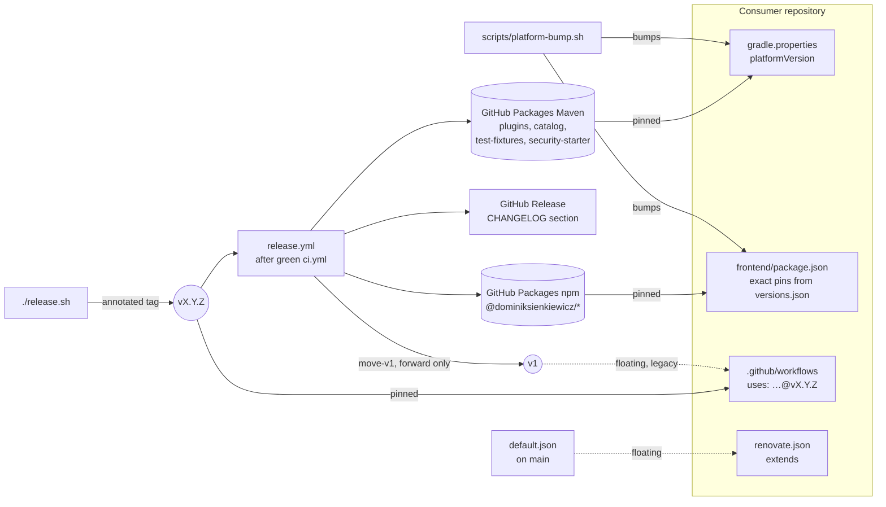

# Platform

**Designed and maintained by [Dominik](https://www.linkedin.com/in/dominik-sienkiewicz/), built with AI coding agents:** I set the architecture, write the specifications, define the quality gates enforced in CI and review every change.

A shared build platform for a multi-repository JVM and frontend organisation. Build
configuration, quality gates, dependency versions and frontend presets live here once,
are published as versioned artifacts, and are consumed like any other dependency.

> Registry: **GitHub Packages** (Maven + npm). Frontend workspaces: **pnpm** in this repository;
> consumers use **npm** with a committed `package-lock.json`, because `frontend-ci` runs `npm ci`
> and `platform-bump` updates that lockfile.

## Why this exists

Several product repositories grew from one template and drifted apart — different
formatters, different dependency versions, the same fix applied three times or forgotten
in two. Copying configuration between repositories is what caused the drift, so the
platform does not copy it: it publishes it.

The reason this is a separate repository rather than shared build logic is a constraint,
not a preference. **`buildSrc` and composite builds are scoped to a single repository** —
neither can be consumed across a repository boundary. A published, versioned artifact is
the only mechanism that crosses that boundary, which also means a consumer upgrades on its
own schedule and rolls back by pinning an older version.

## What it publishes

| Path | Artifact | Published to | Adopted by |
|---|---|---|---|
| `gradle/build-logic/` | four convention plugins (`seniordev.*-conventions`, including settings) | GitHub Packages (Maven) | all five |
| `gradle/catalog/` | version catalog (`pl.seniordeveloper:platform-catalog`); its bundles `modulith-web`, `modulith-web-tests` and `dev-docker-compose` are *incubating* | GitHub Packages (Maven) | all five; the bundles none |
| `gradle/security-starter/` | `pl.seniordeveloper:platform-security-starter` — configurable SecurityFilterChain and CORS (*incubating*) | GitHub Packages (Maven) | none |
| `gradle/test-fixtures/` | `pl.seniordeveloper:platform-test-fixtures` (Testcontainers, test databases, migration and OpenAPI contract guards) | GitHub Packages (Maven) | all five |
| `frontend/packages/tsconfig/` | `@dominiksienkiewicz/tsconfig` | GitHub Packages (npm) | the four frontends |
| `frontend/packages/eslint-config/` | `@dominiksienkiewicz/eslint-config` | GitHub Packages (npm) | the four frontends |
| `frontend/packages/tailwind-preset/` | `@dominiksienkiewicz/tailwind-preset` (CSS-first `@theme`) | GitHub Packages (npm) | Azimuth, BookOfStyling, SkillSprintPlus |
| `frontend/packages/vitest-config/` | `@dominiksienkiewicz/vitest-config` (jsdom + Testing Library) | GitHub Packages (npm) | the four frontends |
| `frontend/packages/prettier-config/` | `@dominiksienkiewicz/prettier-config` — Prettier with the Tailwind class sorter (*incubating*) | GitHub Packages (npm) | none |
| `frontend/packages/versions/` | `@dominiksienkiewicz/versions` — the frontend version canon, the `platform-versions-check` guard that `frontend-ci` runs in strict mode, the `platform-bump` bin and the `platform-templates-check` drift report | GitHub Packages (npm) | the four frontends |
| `frontend/packages/openapi/` | `@dominiksienkiewicz/openapi` — `platform-openapi-gen` and `platform-openapi-check`: TypeScript types generated from the committed OpenAPI spec (*incubating*) | GitHub Packages (npm) | none |
| `frontend/packages/api-client/` | `@dominiksienkiewicz/api-client` — shared `fetch` wrapper, typed by the generated OpenAPI `paths` (*incubating*, private) | not published; 1.5.31 is the last release in GitHub Packages | none |
| `frontend/packages/query/` | `@dominiksienkiewicz/query` — shared TanStack `QueryClient` and provider (*incubating*, private) | not published; 1.5.31 is the last release in GitHub Packages | none |
| `frontend/packages/ui-registry/` | `@dominiksienkiewicz/ui` — shadcn registry sources: `utils` and `button` (*incubating*) | GitHub Packages (npm); the built registry JSON is not shipped or hosted yet | none |
| `infra/` | `docker-compose` template (pgvector, optionally Ollama) | copied / submodule | not audited |
| `.github/workflows/` | eleven reusable workflows, listed [below](#reusable-workflows) | called as `uses: …@vX.Y.Z` | all five; `platform-bump.yml` and `api-contract.yml` none |
| `default.json` | shared Renovate preset for GitHub Actions and Docker images; Platform pins move with `platform-bump` | `extends: github>DominikSienkiewicz/Platform` | none has a Renovate branch |
| `templates/` | canonical files every repository keeps a copy of: the JVM starters, `.editorconfig`, `.sdkmanrc`, the `.gitignore` set, `Dockerfile.backend`, `npmrc`, `grype.yaml`, the scripts `merge.sh`, `platform-bump.sh` (stub), `bump-version.sh`, `agent-gradle.sh` and `setup-gh-deploy.sh` with `secrets.local.example`, the roadmap toolkit and the GitHub files; each one is listed in [templates/README.md](templates/README.md) | copied; `platform-templates-check` reports drift | not audited |
| `scripts/` | scripts Platform's own workflows run: `deploy-remote.sh` (on the deploy host, through `deploy.yml`), `changelog-section.sh` (release notes), `cleanup-packages.sh` (manual package cleanup), `canon-package-json.mjs` (canon CVE scan), and the maintainer's `consumer-audit.sh`, `repo-settings.sh` (GitHub settings as code, with `.github/rulesets/`) and `write-verification-metadata.sh` (Gradle dependency verification of Platform's modules) | not published | — |

*Incubating* artifacts are published and versioned with everything else, but no product
repository has adopted them yet. Treat their API as provisional until the first one does: that
repository's adoption pull request removes the label here. How to adopt the bundles and the security
starter is in [docs/consuming.md](docs/consuming.md#catalog-bundles-incubating).

`api-client` and `query` are also private: no frontend adopted them, and `api-client` overlaps the
clients the consumers generate from OpenAPI. Releases skip them, and they stay at 1.5.31 in the
registry until a first consumer adopts one; that pull request removes `"private": true` too.
Attestate's `providers.tsx` matches `query` one to one.

Every published artifact, with its exact coordinates, and how a release reaches each registry are
described in [RELEASING.md](RELEASING.md).

## Consumers

| Repository | Layout |
|---|---|
| `DominikSienkiewicz/Attestate_io` | backend and frontend |
| `DominikSienkiewicz/Azimuth` | backend and frontend |
| `DominikSienkiewicz/BookOfStyling_com` | backend and frontend |
| `DominikSienkiewicz/SkillSprintPlus_com` | backend and frontend |
| `DominikSienkiewicz/Touchstone` | multi-module backend, no frontend |

"The four frontends" above are the first four. The list is [`scripts/consumers.txt`](scripts/consumers.txt), which
`scripts/consumer-audit.sh` reads: it prints each repository's Platform pin, Gradle wrapper, runtime
image, Platform artifacts, workflow references and `platform-bump.yml` caller, with GET requests
only. Its output describes private repositories, so it runs on the maintainer's machine, not in CI.
The "Adopted by" column is from its run on 2026-10-18; an adoption pull request updates it.

### Reusable workflows

Consumers call them as `uses: DominikSienkiewicz/Platform/.github/workflows/<name>.yml@vX.Y.Z`, with
the tag of their Platform pin. Triggers are declared by the calling workflow; the platform keeps only
the logic. What each caller must grant and pass, with a snippet per workflow, is in
[docs/reusable-workflows.md](docs/reusable-workflows.md).

| Workflow | What it does |
|---|---|
| `backend-ci.yml` | runs the Gradle tasks of a Spring backend (default `build`) on the platform toolchain |
| `frontend-ci.yml` | installs, lints, type-checks, tests and builds a frontend; `strict: true` makes every standard script and the `platform-versions-check` guard mandatory, and checks the OpenAPI types of a repository that configures `platform.openapi` |
| `api-contract.yml` | fails a pull request that breaks the committed OpenAPI spec (oasdiff), unless it carries the `api-breaking` label; see [docs/api-contracts.md](docs/api-contracts.md) |
| `sonar.yml` | **Deprecated:** SonarQube Cloud analysis for a backend + frontend monorepo; no consumer calls it, so run the `sonar` task in your backend job instead |
| `scorecard.yml` | OpenSSF Scorecard |
| `security-scan.yml` | dependency CVE scan: CycloneDX SBOM + Grype for the backend, `package-lock.json` for the frontend; CRITICAL and HIGH fail the build |
| `semgrep.yml` | Semgrep SAST over the source code |
| `container-scan.yml` | scans published images: Grype is the gate, Snyk a non-blocking second opinion |
| `deploy.yml` | builds and pushes images to GHCR, then deploys over SSH with [`scripts/deploy-remote.sh`](scripts/deploy-remote.sh) |
| `roadmap-unblock.yml` | moves roadmap items to ready once their last prerequisite issue is closed |
| `platform-bump.yml` | bumps the repository to a Platform release and opens a pull request with the diff, release notes and consumer actions |

### Convention plugins

| Plugin | What it brings |
|---|---|
| `seniordev.settings-conventions` | applied in `settings.gradle.kts`: the Foojay toolchain resolver and the dependency repositories (an optional `platformRepository`, Maven Central, GitHub Packages) |
| `seniordev.java-conventions` | toolchain 27, Spotless (Google Java Format), Checkstyle (`maxWarnings=0`), JaCoCo with coverage summed across `test` **and** `integrationTest`, a configurable coverage threshold (`coverageMinimum`, default 0.00), and the dependency version and runtime image gates |
| `seniordev.quality-conventions` | PIT (mutation testing), SpotBugs (report-only, see [ADR-0005](docs/adr/0005-spotbugs-report-only.md)), CycloneDX (SBOM), SonarQube Cloud |
| `seniordev.spring-modulith-conventions` | Boot / Modulith / Spring AI BOMs (GA) with JDK 27 compatibility overrides (Lombok, runtime ArchUnit), shared test dependencies (Modulith-test, Testcontainers, ArchUnit), enforced `junit-bom`, and a unit ‖ integration test taxonomy |

Every task, property and default they add is listed in [docs/reference.md](docs/reference.md).

## How it fits together

Three channels are pinned to one release: the Gradle plugins and catalog, the npm packages and the
reusable workflows. `platform-bump` moves all three and prints the notes of every release it
crosses. Two references float: the
Renovate preset is read from `main` on every Renovate run, and `@v1` moves on every release, which
is why a new caller pins the exact tag instead ([ADR-0002](docs/adr/0002-release-and-versioning-contract.md)).

## Reference consumers

[`templates/jvm/`](templates/jvm/) contains a pure Java library and a minimal Spring
application. Gradle TestKit consumes locally published plugins and catalog artifacts
using these templates. Main CI includes all four published Maven modules; a failed
UI registry build blocks npm publication. Consumers can opt into mandatory frontend
checks with `strict: true`.

Platform's own Java modules, `test-fixtures` and `security-starter`, apply `seniordev.java-conventions`
and `seniordev.quality-conventions` from `gradle/build-logic` through `includeBuild`, so the code shipped
to consumers passes the same Spotless, Checkstyle, coverage, `platformDependencyCheck` and SpotBugs gates;
they keep Java 25 bytecode. The `sonar` job of `ci.yml` analyses both in SonarQube Cloud.

## Documentation

- **Consuming the platform in a product repository** → **[docs/consuming.md](docs/consuming.md)** —
  the Gradle `settings.gradle.kts` and `build.gradle.kts` wiring, and the frontend
  `tsconfig` / ESLint / Tailwind / Vitest setup.
- **Every task, property and default the plugins add** → **[docs/reference.md](docs/reference.md)** —
  with the security starter properties and the test fixtures.
- **Building and publishing locally** → **[docs/local-development.md](docs/local-development.md)** —
  bootstrap, GitHub Packages credentials, and how a local build works without GitHub.
- **Where versions are declared** → **[docs/versions.md](docs/versions.md)** — the single
  source of truth, the versions mirrored in convention plugin sources, and dependency locking.
- **Which Java, Gradle, Spring and Node each release brings** →
  **[docs/compatibility.md](docs/compatibility.md)**.
- **Releasing a new version** → **[RELEASING.md](RELEASING.md)** — what a release publishes,
  idempotency per registry, and how consumers adopt the new version.
- **What changed and what consumers must do** → **[CHANGELOG.md](CHANGELOG.md)**.
- **Canonical files to copy into a repository** → [templates/README.md](templates/README.md); the
  local development stack (PostgreSQL with pgvector, Ollama) → [infra/README.md](infra/README.md).
- **Design decisions** → [`docs/adr/`](docs/adr/), including the
  [release and versioning contract](docs/adr/0002-release-and-versioning-contract.md).
- **What the security scans gate and how to accept a finding** →
  [docs/security-scanning.md](docs/security-scanning.md).
- **Reporting a vulnerability** → [SECURITY.md](SECURITY.md).

### Documentation language

Everything a consumer or an outside reader sees is in English: this README, `docs/**`, RELEASING.md,
the `templates/**` and `infra/` READMEs, the pull request templates, package descriptions, workflow
input descriptions and the messages of every gate. Polish appears only in CLAUDE.md and in code and
workflow comments, which are written for the maintainer.

## Requirements

JDK 25 or newer to run Gradle: `build-logic`, `test-fixtures` and `security-starter` compile
to Java 25 bytecode. Consumers compile on toolchain 27, which Foojay provisions locally when it
is not installed; the reusable CI workflows install it with `setup-java` instead
([`docs/versions.md`](docs/versions.md)). The backend runtime image is `sapmachine:27-jre`.
Consumers run Gradle 9.6.1 or newer: TestKit builds a consumer on that minimum and on the 9.8.1 of
Platform's own wrappers, and `platform-bump` moves a consumer's wrapper to the catalog's version.
Node.js ≥ 22.13 (built with Node 24) and pnpm 11.18.0 for the frontend packages, which declare the
Node range in `engines`. Earlier releases are in the [compatibility matrix](docs/compatibility.md).

## License

[MIT](LICENSE) — Copyright (c) 2026 Dominik Sienkiewicz.

The licence is also declared in the POM metadata of every published Maven artifact (`catalog`,
`build-logic`, `test-fixtures`, `security-starter`) and in the `license` field of every npm
package, so a consumer's dependency scanner sees it without reading this repository.
